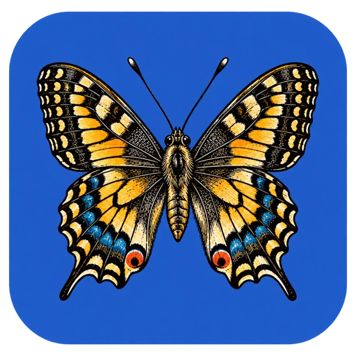
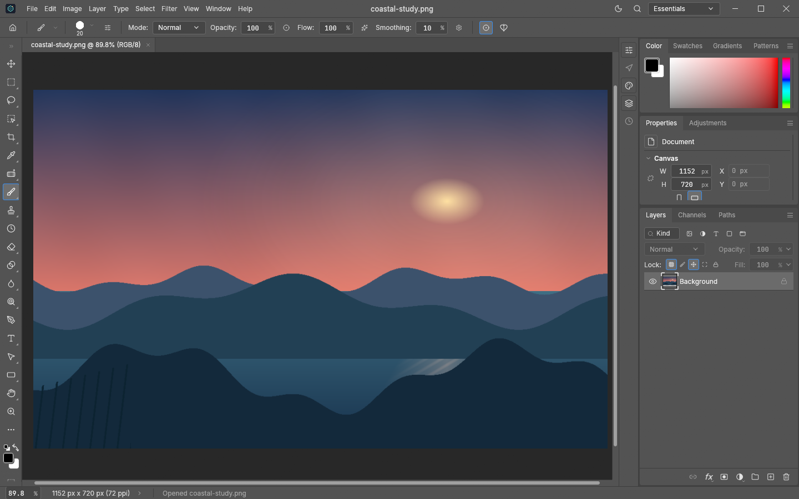
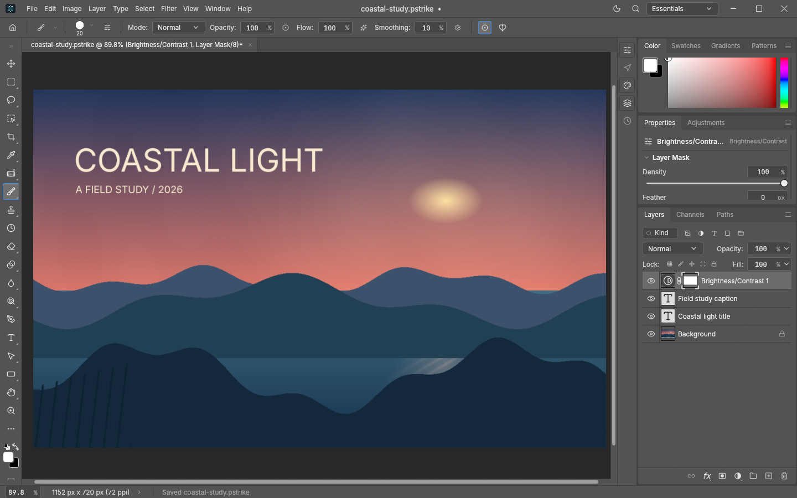

<p align="center">
  
</p>

<h1 align="center">PhotoStrike</h1>

<p align="center">
  <a href="https://prowebdevsolutions.com"><picture>
    <source media="(prefers-color-scheme: dark)" srcset="assets/branding/PWDS-logo-orange.svg">
    
  </picture></a>
</p>

<p align="center"><strong>Build an image, layer by layer.</strong></p>

<p align="center">A native desktop workspace for raster images and editable layered documents. Open an image, make changes in layers, keep a <code>.pstrike</code> master, and export a flat PNG when you need to share it.</p>

<p align="center"><a href="#inside-the-workspace">Workspace</a> · <a href="#current-status">Current status</a> · <a href="#build-and-verification">Build</a> · <a href="SOURCE_SCOPE.md">Credits and source scope</a></p>

## Rust direction and migration status

- **Target:** A Rust-native raster and layered-document editor, extending the selected PhotoCraft foundation rather than rewriting its existing Rust core.
- **Current implementation:** The [Cargo workspace](Cargo.toml) and [desktop entry point](apps/photocraft/src/main.rs) are already Rust, with PhotoStrike document, save-safety and desktop adaptations.
- **Remaining migration:** Continue the Rust foundation work and validate broader format compatibility, native interaction, accessibility, other platforms and packaging. The Windows alpha is not a completed product or general compatibility claim.


*The running Windows alpha with the saved, lettered coastal poster at 1440 × 900. The [coastal study](assets/screenshots/coastal-study.png) was made for this README; it is sample artwork, not a stock or client image. The title and caption are actual editable type layers.*

## Inside the workspace

### Keep the canvas editable

The canvas, paint controls, color picker, document properties, and layer stack share one desktop window. In this example, an imported PNG sits beneath two editable type layers. The earlier workspace state below shows the base art before the title and caption were added. The finished poster above is the actual saved `coastal-study.pstrike` project.



### Explore adjustments

The Adjustments tab offers image adjustment choices beside the canvas. The screenshot shows a new Brightness/Contrast adjustment layer with its mask selected in the layer stack. It does not demonstrate a tuned brightness or contrast result; individual adjustment behavior and broad compatibility still need interactive review.



### Save a master, export a flat image

Use `.pstrike` for the editable document. Reopening a saved project retains its separate layer assets; exporting PNG creates a flat image for use elsewhere. Bounded native-control checks reopened a two-layer project and compared independent PNG exports byte for byte. Save guards refuse changed or occupied destinations and malformed files, with the limits noted below.

## Current status

PhotoStrike is **Windows alpha source**, not a packaged release. Synthetic native-control checks covered a two-layer save and reopen, PNG export, and several save guards. This README's screenshots are historical Windows-alpha captures from before the approved-logo runtime integration; they are not evidence of the current runtime branding. Current source uses the earlier approved butterfly branding in the title bar and native window, with derived Windows executable icon sizes; this README masthead uses the updated website icon. Fresh native evidence is captured from the exact checked revision by the **Required native Windows branding** workflow job, separately from these historical images. Interactive pointer and accessibility review, broad file compatibility, other platforms, and installer packaging remain open.

## Build and verification

PhotoStrike is a native Rust raster and layered-document editor adapted from PhotoCraft. The clean standalone Windows alpha source passed focused format and automation save-guard tests, 4/4 desktop save tests, and 10/10 save identity tests. Its rebuilt `photostrike.exe` passed a synthetic native-control regression covering two-layer `.pstrike` save/reopen, PNG export, external-edit and occupied-file guards, and malformed-file refusal. The earlier Windows acceptance also verified all four non-manifest assets survived a normal round trip and independent PNG exports were byte-identical. Interactive pointer and accessibility acceptance remain open.

From this source root:

```powershell
cargo build --locked -p photocraft --bin photostrike
cargo run --locked -p photocraft --bin photostrike
```

The Cargo package and internal crate names remain `photocraft-*` for compatibility. Its local workspace, lockfile, UI icons, fonts, dictionary, and contributor data are included. Optional `CRAFT_FONTS_DIR` fonts are not bundled. A fresh machine needs ordinary crates.io access for uncached dependencies. The clean standalone Windows build required successful version-resource compilation. Current native-branding CI sets `PHOTOSTRIKE_REQUIRE_WINRES=1`, checks the compiled executable icon resources against the approved derivatives, and retains a new source-bound native capture; none of these checks establishes installer or release acceptance.

The OS Save As overwrite prompt has not been clicked end-to-end. A narrow race remains between the final opened-file hash check and replacement rename when another process writes at the same time. RAW development and catalog integration with LightCraft, catalog search, and downloaded models are not implemented here. Other platforms, release packaging, and installers are not verified or supported by this candidate.

See [SOURCE_SCOPE.md](SOURCE_SCOPE.md) for donor attribution, source ownership, and excluded artwork. No new first-party license grant is stated for PhotoStrike changes.

## PWDS brand artwork

The company mark in this masthead is the existing [official PWDS logo](https://github.com/Gerbzz/PWDS-Website/blob/main/public/prowebdevsolutions-logo.png), with the [official orange display asset](https://prowebdevsolutions.com/images/prowebdevsolutions-logo-orange.svg) for dark backgrounds. The app logo above it remains the original Strike suite artwork.
